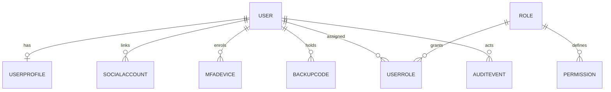
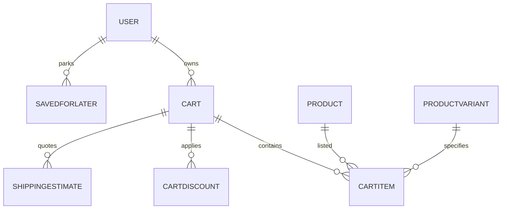
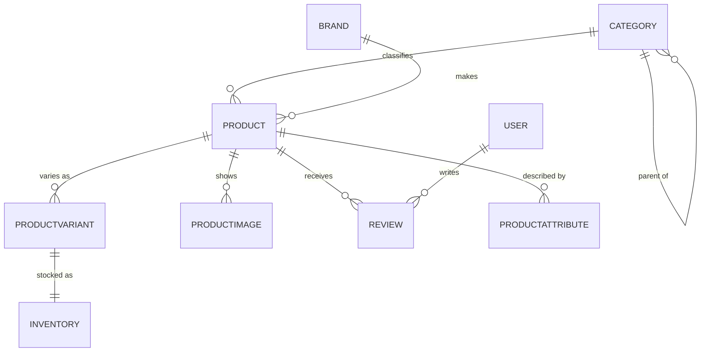
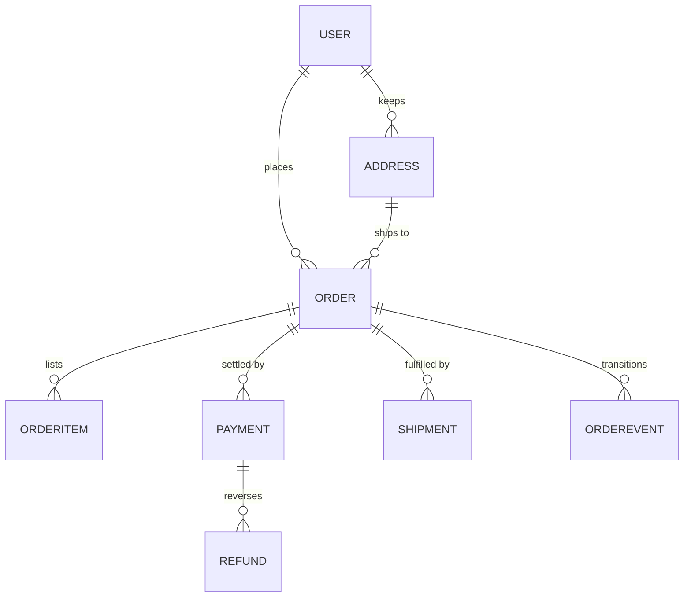

# Data Model & Entity Relationship Diagram

| | |
|---|---|
| **Document ID** | REKA-DAT-001 |
| **Version** | 0.1 (Draft) |
| **Owner** | Data Architect / Tech Lead |
| **Generation** | Diagrams are hand-authored here for review. Once the models exist, regenerate from `python manage.py graph_models` and treat the generated output as authoritative. |

---

## 1. Scope and reading order

Four diagrams rather than one. A single diagram covering fifteen modules is unreadable at any zoom level, and edges cross no matter how it is laid out. Each module is drawn separately with its foreign keys to other modules noted in text.

1. Identity & access — built
2. Cart — built
3. Catalogue — Phase 1
4. Orders & payments — Phase 3

**PII column** classifies every field for POPIA purposes: **D** direct identifier · **I** indirect identifier · **S** special personal information (POPIA s26) · **F** financial · **—** non-personal. This classification feeds the personal information inventory in the POPIA pack and determines encryption and retention obligations.

---

## 2. Identity & access



### USER

| Field | Type | PII | Notes |
|---|---|---|---|
| id | BigAuto PK | — | |
| email | Email, unique | **D** | Login identifier. Case-insensitive unique index required |
| username | Char, unique | **I** | |
| phone_number | Char, null | **D** | Required for SMS MFA and courier contact |
| password | Char | — | Argon2 hash. Never logged, never serialised |
| email_verified | Bool | — | Must be true before an order may be placed |
| is_active | Bool | — | |
| date_joined, last_login | DateTime | **I** | |

**Constraints.** `UNIQUE(LOWER(email))`. `CHECK (email_verified IS NOT NULL)`.

### USERPROFILE

| Field | Type | PII | Notes |
|---|---|---|---|
| user | OneToOne → USER | — | |
| first_name, last_name | Char | **D** | |
| address | Text | **D** | **Move to a dedicated `Address` model in Phase 3.** A single text field cannot serve shipping, billing and an address book |
| avatar | Image | **I** | Stored in object storage, not the database |
| date_of_birth | Date, null | **D** | Collect only if age verification is actually required. If not, do not collect — POPIA s10 minimality |
| preferences | JSON | — | |

### ROLE / PERMISSION / USERROLE

| Model | Field | Notes |
|---|---|---|
| ROLE | name (unique), description, is_active, created_at | |
| PERMISSION | role FK, **module (choice)**, can_create, can_read, can_update, can_delete | `UNIQUE(role, module)` |
| USERROLE | user FK, role FK, granted_by FK, granted_at | `UNIQUE(user, role)` |

> **Three changes from the current code**, all blocking per ADR-0010:
> 1. `USERROLE` **does not exist today.** No link between `User` and `Role` appears anywhere in the reviewed files, which means roles grant nothing. This is the highest-priority data model gap.
> 2. `Permission.module` must become a choice field from a shared enumeration. Free text cannot be matched at check time.
> 3. `Permission.action` must be dropped — it duplicates the four `can_*` booleans. Two representations of one fact will diverge.

### MFADEVICE / BACKUPCODE

| Model | Field | PII | Notes |
|---|---|---|---|
| MFADEVICE | user, device_type, identifier, **secret**, is_active, created_at, last_used_at | **D** on identifier | `secret` encrypted at rest with a key from the secret store, **never** in a serializer |
| BACKUPCODE | user, code_hash, used_at | — | Hashed, not stored in plaintext. `BackupCodesSerializer` currently returns codes — correct at generation, once |

> `MFADeviceSerializer` currently exposes `identifier`. For an SMS device that is a phone number and for email a mail address — both direct identifiers. Mask on output (`+27•••••1234`).

### SOCIALACCOUNT

| Field | PII | Notes |
|---|---|---|
| user, provider, provider_id, access_token, refresh_token, token_expires | **D** on provider_id | `UNIQUE(provider, provider_id)`. Tokens encrypted at rest. **`provider_id` must not appear in any response body** — the current serializer exposes it |

### AUDITEVENT

| Field | Notes |
|---|---|
| actor FK null, event_type, object_type, object_id, before JSON, after JSON, ip, user_agent, created_at | Append-only. Application has INSERT but not UPDATE or DELETE. See Access Control Matrix §10 |

---

## 3. Cart



### CART

| Field | Type | PII | Notes |
|---|---|---|---|
| id | PK | — | |
| user | FK → USER, null | **I** | Null for guest carts |
| session_id | Char, null, indexed | **I** | Guest identity. See ADR-0005 |
| is_active | Bool | — | |
| created_at, updated_at | DateTime | — | |

**Constraints — three are missing today and all are load-bearing:**

```sql
-- One active cart per user. Without this, get_or_create() raises
-- MultipleObjectsReturned the first time two requests race.
CREATE UNIQUE INDEX cart_one_active_per_user
  ON cart (user_id) WHERE is_active AND user_id IS NOT NULL;

CREATE UNIQUE INDEX cart_one_active_per_session
  ON cart (session_id) WHERE is_active AND session_id IS NOT NULL;

-- A cart belongs to exactly one identity, never both, never neither.
ALTER TABLE cart ADD CONSTRAINT cart_single_identity
  CHECK (num_nonnulls(user_id, session_id) = 1);
```

### CARTITEM

| Field | Type | Notes |
|---|---|---|
| cart | FK → CART, cascade | |
| product | FK → PRODUCT, protect | Never cascade — deleting a product must not silently empty carts |
| variant | FK → PRODUCTVARIANT, null, protect | |
| quantity | PositiveSmallInt | `CHECK (quantity > 0)` |
| unit_price_snapshot | Decimal(12,2) | **New.** See below |
| added_at | DateTime | |

> **`unit_price_snapshot` does not exist today and should.** Cart totals currently read live product prices. If a price changes while an item sits in a cart, the customer sees one number at add time and another at checkout. Snapshot the price, then decide the staleness policy explicitly — re-price silently, or notify and require confirmation. Retrofitting this after orders exist is significantly harder.

**Constraints.** `UNIQUE(cart, product, variant)` — required for `get_or_create` to behave, and it currently has no database backing.

**Known defect.** Inventory is validated against the *requested* quantity, not the resulting quantity. Adding 5 of a 6-stock item twice yields 10 in the cart. Re-validate after the `get_or_create` merge and again inside `merge_carts`.

### CARTDISCOUNT

| Field | Notes |
|---|---|
| cart FK, code, discount_type, amount, applied_at | `UNIQUE(cart, code)` — **missing**, and without it the same code stacks without limit. Add `CHECK (amount >= 0)` and, for percentage type, `CHECK (amount <= 100)` |

Phase 2 replaces the hard-coded `"DISCOUNT20"` with a FK to `COUPON` in the Promotions module. `code` remains denormalised for audit.

### SHIPPINGESTIMATE

| Field | Notes |
|---|---|
| cart FK, method_name, price, estimated_days, is_selected, created_at | Partial unique index on `(cart)` where `is_selected` — one selection per cart |

> **Nothing creates these rows.** `select_shipping` reads `ShippingEstimate` objects that no code writes. A rate-generation service is required before checkout functions.

### SAVEDFORLATER

| Field | Notes |
|---|---|
| user FK, product FK, variant FK null, created_at | `UNIQUE(user, product, variant)`. Note this is user-scoped, not cart-scoped — guests have no saved items by design |

---

## 4. Catalogue — Phase 1



| Model | Key fields | Notes |
|---|---|---|
| CATEGORY | name, slug, parent FK self, is_active, sort_order | Self-referential tree. Constrain depth or use `django-mptt` |
| BRAND | name, slug, logo, is_active | |
| PRODUCT | sku unique, name, slug, description, brand FK, category FK, base_price, is_active, created_at | |
| PRODUCTVARIANT | product FK, sku unique, label, price_delta, is_active | `UNIQUE(product, label)` |
| INVENTORY | variant OneToOne, quantity, reserved_quantity, reorder_level, warehouse | See below |
| PRODUCTIMAGE | product FK, variant FK null, url, alt_text, sort_order | Object storage; database holds the key |
| REVIEW | product FK, user FK, rating 1–5, title, body, is_approved, created_at | `UNIQUE(product, user)`. **PII: I** — a review links a named person to a purchase |
| PRODUCTATTRIBUTE | product FK, key, value | Consider JSONB with a GIN index instead if attributes are sparse |

> **`Inventory` is currently a reverse relation queried as `product.inventory.first()` and `variant.inventory.first()`** — implying a ForeignKey where a OneToOne is meant. `.first()` on an unordered queryset returns an arbitrary row. Make it OneToOne per variant, with stock held at variant level only. A product-level quantity alongside variant-level quantities creates two sources of truth.

> **`reserved_quantity` does not exist and is required.** Without a reservation concept, two customers can both check out the last unit. Reserve at order creation, release on cancellation or timeout.

---

## 5. Orders & payments — Phase 3



| Model | Key fields | PII |
|---|---|---|
| ADDRESS | user FK, label, line1, line2, suburb, city, province, postal_code, country, recipient_name, recipient_phone, is_default_shipping, is_default_billing | **D** |
| ORDER | reference unique, user FK protect, shipping_address FK protect, status, currency, subtotal, discount_total, shipping_total, tax_total, grand_total, placed_at | **I** |
| ORDERITEM | order FK, product FK protect, variant FK protect, **product_name_snapshot**, **sku_snapshot**, unit_price, quantity, line_total | — |
| PAYMENT | order FK, provider, provider_reference, status, amount, currency, **card_last4**, **card_brand**, idempotency_key unique, created_at | **F** |
| REFUND | payment FK, amount, reason, provider_reference, created_by FK, created_at | **F** |
| SHIPMENT | order FK, carrier, tracking_number, status, dispatched_at, delivered_at | **I** |
| ORDEREVENT | order FK, from_status, to_status, actor FK null, note, created_at | — |

**Rules.**

- **Snapshot everything on the order.** `product_name_snapshot`, `sku_snapshot` and `unit_price` are copies, not lookups. An order is a historical record; renaming a product must not rewrite last year's invoices.
- **`protect`, not `cascade`, on every order foreign key.** Deleting a user must never delete their order history — tax and consumer-protection law require retention. Deactivate instead. See POPIA pack §7 on the tension between erasure requests and retention obligations.
- **`PAYMENT` stores a token and last four digits only.** No PAN, no CVV, no expiry, ever — including in logs and error reports. See ADR-0011.
- **`idempotency_key` unique** — mobile networks retry, and providers retry webhooks. Without this you will double-charge.
- **`ORDER.status` transitions are validated in code** against an explicit state machine, and every transition writes an `ORDEREVENT`. Do not allow arbitrary status assignment.

---

## 6. Cross-module foreign keys

| From | To | On delete | Rationale |
|---|---|---|---|
| CARTITEM.product | PRODUCT | PROTECT | Deleting a product must not silently empty live carts |
| ORDERITEM.product | PRODUCT | PROTECT | Order history is immutable |
| ORDER.user | USER | PROTECT | Legal retention outlives account deletion |
| REVIEW.user | USER | SET NULL | Anonymise on erasure; keep the review |
| CART.user | USER | CASCADE | A cart has no independent value |
| AUDITEVENT.actor | USER | SET NULL | Keep the event, drop the link |

---

## 7. Indexing

| Table | Index | Reason |
|---|---|---|
| cart | `(session_id) WHERE is_active` | Every guest request |
| cart | `(user_id) WHERE is_active` | Every authenticated cart request |
| cartitem | `(cart_id)` | Serializer prefetch |
| product | `(slug)`, `(category_id, is_active)`, `(brand_id, is_active)` | Listing and filtering |
| productvariant | `(product_id, is_active)` | Variant selection |
| order | `(user_id, placed_at DESC)` | Order history |
| order | `(reference)` unique | Customer support lookup |
| payment | `(idempotency_key)` unique | Retry safety |
| auditevent | `(actor_id, created_at DESC)`, `(object_type, object_id)` | Investigation |

**Known N+1.** `CartSerializer(cart).data` is constructed directly inside `add_item`, `update_item`, `remove_item`, `apply_discount`, `select_shipping` and `clear`, bypassing the `prefetch_related` configured in `get_queryset`. Each call re-queries products and variants per item. Route these through a helper that applies the prefetch.

---

## 8. Migration sequence

Migrations that add constraints will fail against existing data that violates them. Order matters.

| Step | Action | Risk |
|---|---|---|
| 1 | Add `USERROLE`; backfill existing users to a default Customer role | Low |
| 2 | Convert `Permission.module` to choices; map existing free-text values | **Medium** — unmapped values must be resolved manually before the migration runs |
| 3 | Drop `Permission.action` | Low, after step 2 |
| 4 | Deduplicate cart rows, then add the partial unique indexes | **High** — deduplication is a data decision, not a schema one. Which cart survives? |
| 5 | Deduplicate cart items, add `UNIQUE(cart, product, variant)` | Medium |
| 6 | Add `CARTITEM.unit_price_snapshot`, backfill from current product price | Low |
| 7 | Add `CARTDISCOUNT UNIQUE(cart, code)` after removing duplicates | Medium |
| 8 | Convert `Inventory` to OneToOne per variant | **High** — resolve product-level versus variant-level quantities first |

**Rule.** Every migration in steps 4, 5, 7 and 8 requires a written data-remediation plan and a dry run against a production-shaped dataset before it is applied.
