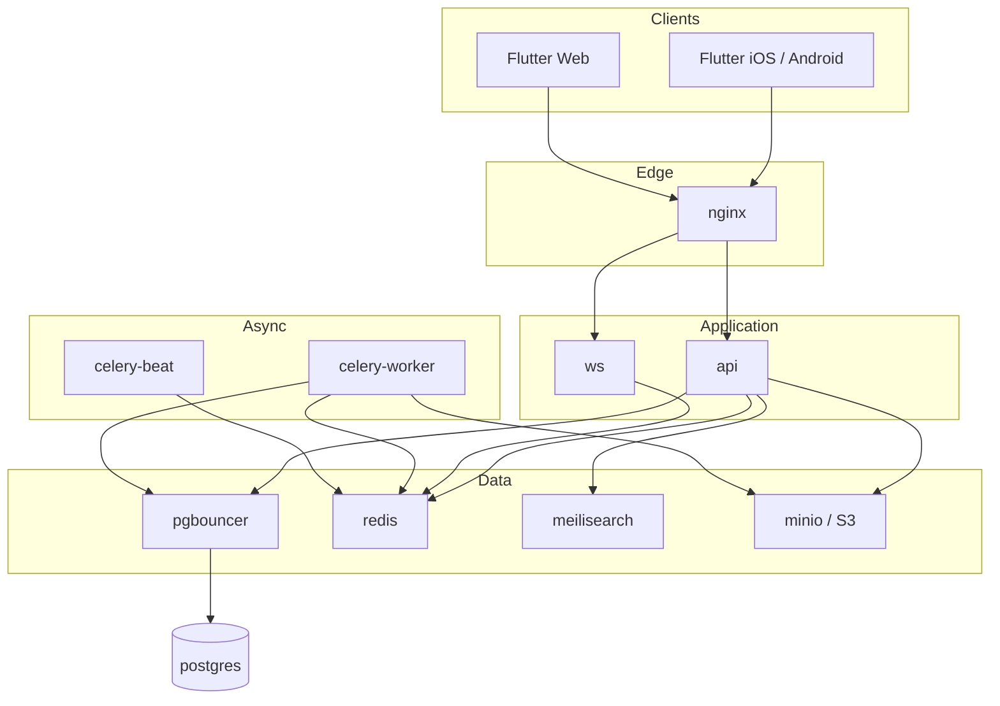

# Environment Specification

| | |
|---|---|
| **Document ID** | REKA-OPS-001 |
| **Version** | 0.1 (Draft) |
| **Owner** | DevOps Engineer |
| **Related** | ADR-0003 (one image, many roles), ADR-0007 (Postgres + Redis) |

---

## 1. Environments

| Environment | Purpose | Data | Who deploys | Availability |
|---|---|---|---|---|
| **local** | Developer workstation | Synthetic, seeded | Anyone | Best effort |
| **ci** | Automated verification | Ephemeral, per-run | Pipeline only | Per build |
| **staging** | Pre-production verification, UAT, load and security testing | Synthetic at production volume | Pipeline on merge to `main` | Business hours |
| **production** | Live | Real customer data | Pipeline on tagged release, manual approval | 99.5% target |

**Rule E-1.** There is no fourth environment. "demo", "sandbox" and "client-preview" become staging with a feature flag, or they become unmaintained systems holding stale credentials.

**Rule E-2.** **No production personal information ever leaves production.** Staging is seeded synthetically. This is a POPIA s19 obligation, not a preference — see POPIA pack §6.

---

## 2. Parity

Identical across all environments — differences here cause the failures that appear only in production:

- PostgreSQL major version, and `postgresql.conf` settings that affect planning
- Redis version
- Python and Flutter SDK versions, pinned exactly
- The application image (same digest promoted through environments, never rebuilt per environment)
- Migration state
- Timezone (UTC) and locale
- TLS termination behaviour and proxy headers

Permitted to differ:

| Aspect | local | staging | production |
|---|---|---|---|
| Replica counts | 1 | 1–2 | 2+ |
| Resource limits | Unbounded | 50% of prod | Full |
| Log level | DEBUG | INFO | INFO (WARNING for third-party libraries) |
| `DEBUG` | True | **False** | **False** |
| Email | Mailpit | Real provider, allowlisted recipients | Real provider |
| Payments | Provider sandbox | Provider sandbox | Live |
| Object storage | MinIO | MinIO or S3 | S3 |
| Search | Meilisearch, 1 node | 1 node | 1 node + replica |
| Monitoring stack | Off | On | On |
| Backups | Off | Daily | Continuous WAL + daily full |

**Rule E-3.** `DEBUG = True` in staging or production is a P0 incident. It exposes settings, stack traces and SQL. CI asserts it is False in any non-local settings module.

---

## 3. Container inventory

**Tier 1 — core, every environment**

| Service | Image | Command | Notes |
|---|---|---|---|
| `api` | `reka/app` | `gunicorn reka.wsgi` | Stateless, horizontally scalable |
| `postgres` | `postgres:16-alpine` | — | Never published to the host in production |
| `redis` | `redis:7-alpine` | — | Cache, broker, Channels, rate limits |
| `celery-worker` | `reka/app` | `celery -A reka worker -Q reka.default` | Email, invoices, images, reports |
| `celery-beat` | `reka/app` | `celery -A reka beat` | Abandoned carts, stock alerts, nightly reports |
| `nginx` | `nginx:alpine` | — | TLS, static, media, `.well-known`, upload limits |

**Tier 2 — feature-driven**

| Service | Serves |
|---|---|
| `ws` (`daphne reka.asgi`) | Live chat, real-time delivery status |
| `meilisearch` | Product search and filtering (pending ADR-0008) |
| `minio` | Product images, media library, avatars |
| `imgproxy` | On-demand image variants. Optional — Celery + Pillow is the fallback |

**Tier 3 — production only**

| Service | Purpose |
|---|---|
| `pgbouncer` | Connection pooling. Gunicorn workers × Celery concurrency exhausts Postgres quickly |
| `celery-worker-priority` | Payment webhooks and order confirmation on a dedicated queue. A backlog of 40,000 marketing emails must never delay a payment capture |
| `flower` | Queue monitoring |
| `pgbackup` | `pg_dump` to object storage on schedule |
| `prometheus` / `grafana` | Metrics and dashboards |
| `loki` / `promtail` | Centralised logs |

**Dev only — Compose profile `dev`**

`mailpit` (SMTP capture, so verification and reset links are clickable), `adminer`, `flutter-build` (Android and Web artefacts), `test-runner`.

**Not containers:** the Flutter mobile application. It is a signed store artefact. Only the Flutter *Web* build is served by a container.

> **iOS builds cannot be containerised.** Docker on Linux cannot run Xcode. A macOS build agent — GitHub Actions `macos-latest`, Codemagic, or a Mac mini — is a hard dependency. Budget for it in Phase 0; teams discover this in release week.

---

## 4. Topology



### Networks

| Network | Members | Exposure |
|---|---|---|
| `edge` | nginx, api, ws | nginx publishes 80/443 |
| `internal` | Everything else. `internal: true` | No host ports |

**Rule E-4.** In production, only nginx publishes a port. Postgres, Redis and Meilisearch must be unreachable from the host and from the internet. This is a large share of what "PCI DSS compliance" and "security monitoring" mean in practice.

---

## 5. Compose layout

| File | Contents |
|---|---|
| `docker-compose.yml` | Tier 1 and 2, no ports, no bind mounts |
| `docker-compose.override.yml` | Auto-loaded locally: bind mounts, `runserver`, dev profile services |
| `docker-compose.prod.yml` | Replicas, resource limits, Tier 3, restart policies |

```bash
# local
docker compose up

# staging / production
docker compose -f docker-compose.yml -f docker-compose.prod.yml up -d
```

Named volumes: `pgdata`, `redisdata`, `mediafiles`, `staticfiles`, `meilidata`.

---

## 6. Configuration

All configuration by environment variable, prefixed `REKA_`. Twelve-factor: no environment-specific code paths, no `if ENVIRONMENT == "production"` branching in business logic.

| Variable | Example | Secret |
|---|---|---|
| `REKA_ENVIRONMENT` | `production` | No |
| `REKA_DEBUG` | `false` | No |
| `REKA_SECRET_KEY` | — | **Yes** |
| `REKA_ALLOWED_HOSTS` | `api.reka.co.za` | No |
| `REKA_DATABASE_URL` | `postgres://reka_app@pgbouncer:6432/reka_prod` | **Yes** |
| `REKA_REDIS_URL` | `redis://redis:6379/0` | **Yes** |
| `REKA_CART_SESSION_HMAC_KEY` | — | **Yes** |
| `REKA_JWT_ACCESS_LIFETIME` | `900` | No |
| `REKA_JWT_REFRESH_LIFETIME` | `1209600` | No |
| `REKA_MFA_ENCRYPTION_KEY` | — | **Yes** |
| `REKA_PAYMENT_PROVIDER` | `peach` | No |
| `REKA_PAYMENT_API_KEY` | — | **Yes** |
| `REKA_PAYMENT_WEBHOOK_SECRET` | — | **Yes** |
| `REKA_EMAIL_URL` | — | **Yes** |
| `REKA_S3_ENDPOINT` / `_KEY` / `_SECRET` | — | **Yes** |
| `REKA_SITE_BRAND_NAME` | `Reka` | No |
| `REKA_MIN_APP_VERSION` | `1.2.0` | No |
| `REKA_SENTRY_DSN` | — | **Yes** |

**Rule E-5.** The application fails to start if a required variable is missing. No silent defaults for anything security-relevant. A missing `REKA_SECRET_KEY` must crash, not fall back.

**Rule E-6.** `REKA_SITE_BRAND_NAME` is the only place the customer-facing name appears server-side (ADR-0013). No brand literal in a template.

---

## 7. Secrets

| Environment | Mechanism |
|---|---|
| local | `.env.local`, git-ignored, seeded from `.env.example` with dummy values |
| ci | Pipeline secret store, masked in logs |
| staging / production | Docker secrets or the platform's secret manager. **Never** environment variables in a committed compose file, never in the image |

| Rule | Detail |
|---|---|
| Rotation | Every 90 days, and immediately on any suspected exposure or team departure |
| Access | Two named people per production secret. Retrieval logged |
| Scanning | `gitleaks` on every commit and across full history on first run |
| A leaked secret is rotated, not deleted from history | Rewriting history does not un-publish anything |

---

## 8. Data policy by environment

| | local | ci | staging | production |
|---|---|---|---|---|
| Real customer data | Never | Never | **Never** | Yes |
| Data source | Seed script | Factories | Synthetic generator at production volume | Live |
| Backups | None | None | Daily, 7-day retention | Continuous WAL + daily full, 35 days |
| Restore drill | — | — | Monthly | Quarterly, timed |
| Encryption at rest | No | No | Yes | Yes |

**Rule E-7.** A backup that has never been restored is not a backup. The restore drill is timed and the result recorded — the number produced is the real RTO, regardless of what the DR plan claims.

---

## 9. Access

| Environment | Application | Database | Container shell |
|---|---|---|---|
| local | Anyone | Anyone | Anyone |
| staging | Team, IP-allowlisted | Read-only, named accounts | Team |
| production | Public (application) | **Break-glass only**, logged, MFA | **Break-glass only**, logged, MFA, time-boxed |

Django admin in production: internal path, VPN or IP allowlist, mandatory MFA, 30-minute idle timeout, every action audited. See Access Control Matrix §9.

---

## 10. Promotion

```
feature branch → PR → CI → merge to main → staging (automatic)
                                              ↓
                                      tag release → manual approval → production
```

The **same image digest** promotes through environments. Never rebuild per environment — a rebuild is a different artefact, and the thing you tested is not the thing you shipped.

### Deployment sequence

1. Build and tag the image
2. Push to registry
3. Run migrations in a one-shot container **before** any role starts on the new revision
4. Roll `api` and `ws`, health-check gated
5. Roll `celery-worker`, `celery-worker-priority`, `celery-beat`
6. Smoke tests against production
7. Watch error rate and latency for 15 minutes

**Rule E-8.** Migrations must be backward-compatible with the running revision for the duration of the roll. Additive first, remove in a later release. A column dropped in the same deploy that stops using it will break every request served by an old container still draining.

### Rollback

Redeploy the previous image digest. **Migrations do not roll back automatically** — a destructive migration must be reversed by a written plan prepared before it is applied. This is why step 8 of the Data Model migration sequence requires a remediation plan.

---

## 11. Observability

| Signal | Tool | Retention |
|---|---|---|
| Metrics | Prometheus → Grafana | 90 days |
| Logs | Loki, structured JSON, `X-Request-ID` on every line | 30 days hot, 12 months cold |
| Errors | Sentry, with PII scrubbing enabled | 90 days |
| Traces | OpenTelemetry (service names `reka-api`, `reka-worker`, `reka-ws`) | 7 days |
| Audit | Append-only store, separate from application logs | 7 years |

**Rule E-9.** No personal information in logs. Scrub email addresses, phone numbers, addresses, tokens and session identifiers at the logging formatter, not at the call site. Relying on developers to remember at every call site fails within a week.

### Service level objectives

| SLI | SLO |
|---|---|
| API availability | 99.5% monthly |
| Checkout success rate | > 99.0% |
| API p95 latency | < 500 ms |
| Payment webhook processing | < 30 s p99 |
| Celery queue depth (priority) | < 100 sustained |

### Alerts

| Condition | Severity |
|---|---|
| Checkout error rate > 1% for 5 min | Page |
| Payment webhook failures > 3 in 10 min | Page |
| Database connections > 80% of pool | Page |
| Disk > 85% | Page |
| Priority queue depth > 500 | Page |
| p95 latency > 1 s for 10 min | Warn |
| Certificate expiring < 14 days | Warn |
| Failed login rate anomaly | Warn — possible credential stuffing |

---

## 12. Capacity

Baseline production sizing. Revisit after the first load test — these are starting points, not measurements.

| Service | CPU | Memory | Replicas |
|---|---|---|---|
| `api` | 1 | 1 GB | 2 |
| `ws` | 0.5 | 512 MB | 1 |
| `celery-worker` | 1 | 1 GB | 2 |
| `celery-worker-priority` | 0.5 | 512 MB | 1 |
| `celery-beat` | 0.25 | 256 MB | 1 (**never more than one**) |
| `postgres` | 2 | 4 GB | 1 + standby |
| `redis` | 0.5 | 1 GB | 1 |
| `meilisearch` | 1 | 1 GB | 1 |
| `nginx` | 0.5 | 256 MB | 2 |

**Rule E-10.** `celery-beat` must run as exactly one replica. Two schedulers means every scheduled task fires twice — including abandoned-cart emails and, if it ever schedules one, anything that moves money.
